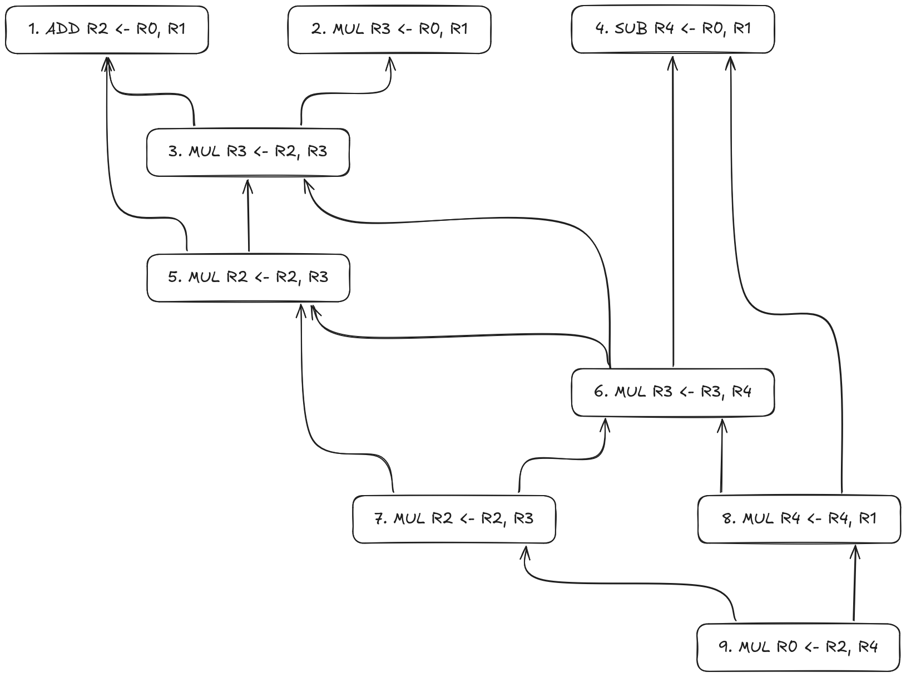
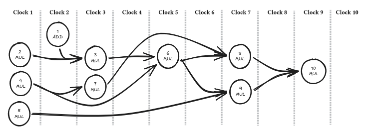

1. 1. 3 cores * 1 billion cycles/sec = 3 billion flop/sec
   2. 3 cores * 1 billion cycles/sec * 8 flop/cycle = 24 billion flop/sec
   3. If all hardware threads share the same SIMD unit, then the additional
      threads have no impact on total flops.
   4. 3 cores * 1 billion cycles/sec * 9 flop/cycle = 27 billion flop/sec
2. 1. This graph includes both read-after-write (RAW) dependencies and
   write-after-read (WAR) dependencies. Some of the WAR edges may not be
   required depending on if parallel execution of the instructions guarantee that
   all writes happen after all reads.  
   2. 10cycles:  
   3. No, adding additional superscalar execution units will not improve the
      performance of this set of instructions since there is as fundamental
      dependency path between instructions 2->3->6->8->10 that limits the amount
      of instruction level parallelism that can be extracted from this
      instruction stream.
3. 1. 2/3 exam/minute.
   2. 9 minutes. Technically, this is the minimum latency. This assumes there
      are no other exams in piles delaying grading which would add to latency.
      The maximum latency would be 10 minutes, if an exam needs to be queued for
      1 minute waiting for the CA of question 3 to complete work. After that,
      there should be no queuing. And this additional latency could be entirely
      removed by staggering the processing of question 1 by one minute.
4. 1. 
   2. 
5. 1. 
   2. 
